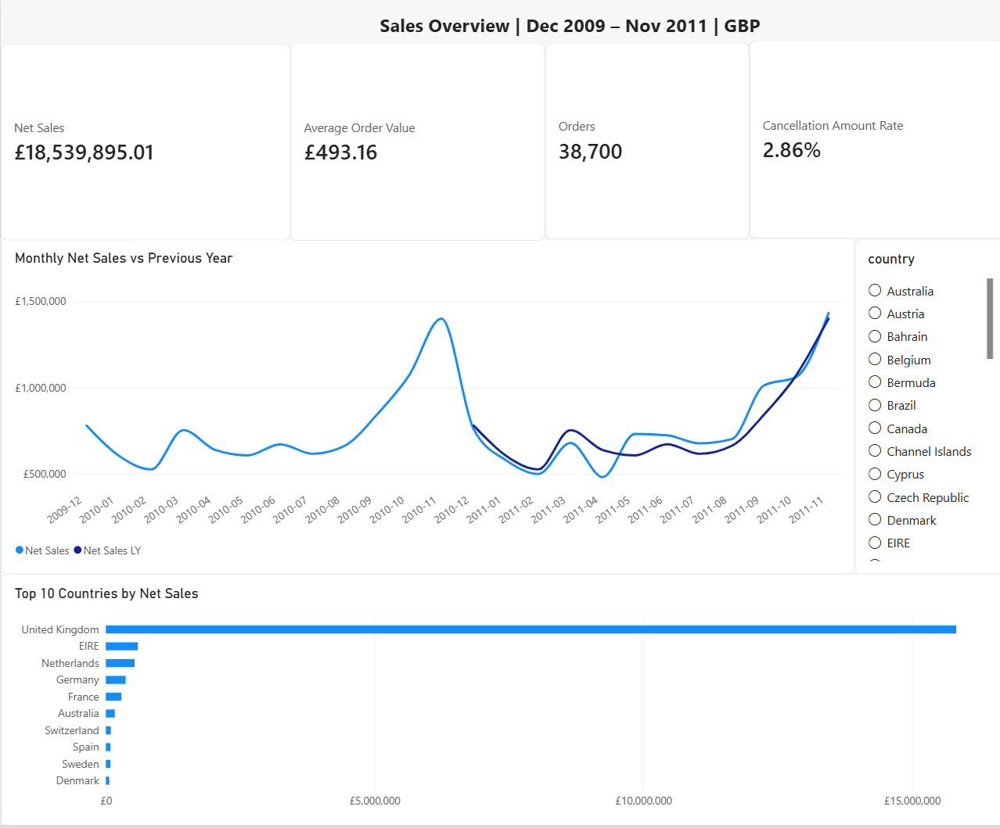
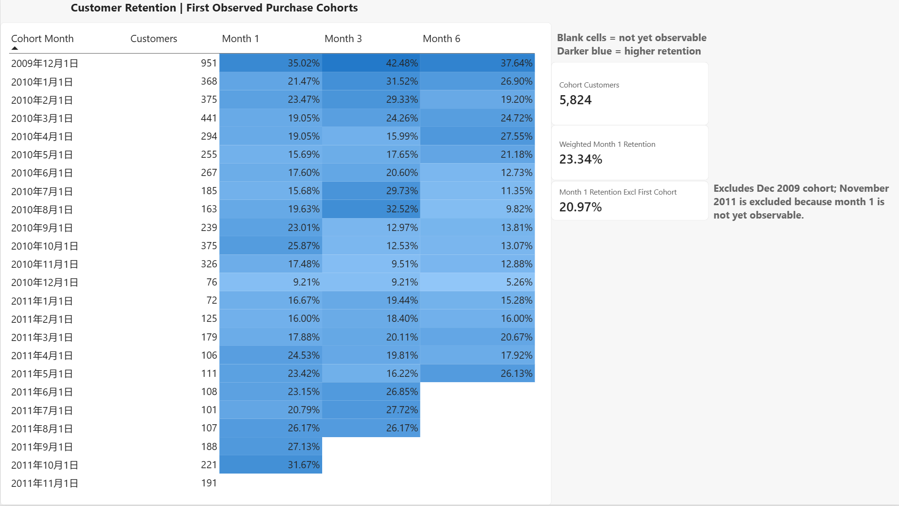
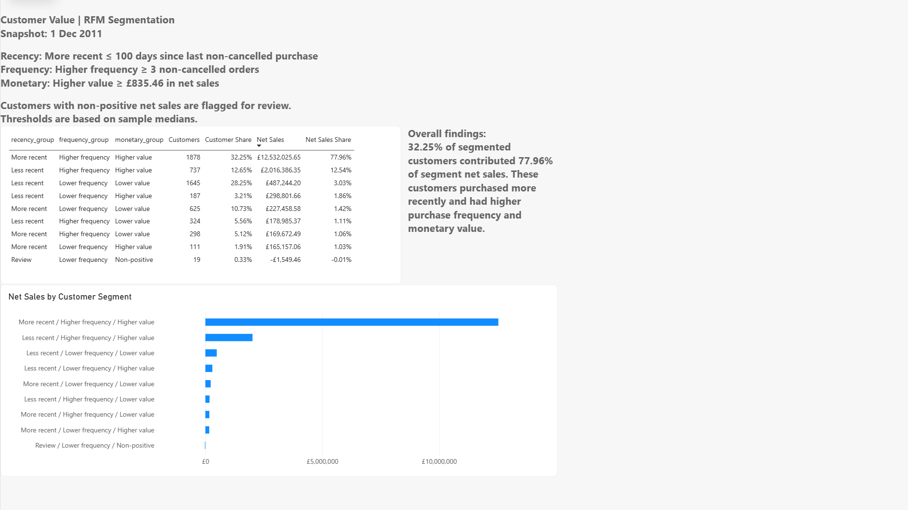

# Online Retail II — Sales Analytics

**Status: historical analysis, dashboard, business report and experiment proposal completed. Local reproducibility review is documented in [VALIDATION.md](VALIDATION.md).**

A personal portfolio project investigating historical retail transactions with Python/pandas, PostgreSQL and Power BI. The goal is to connect data-quality decisions to interpretable sales, customer and product metrics. PostgreSQL analysis now covers sales diagnostics, observed repeat purchasing, cohort retention and exploratory customer segmentation. A three-page Power BI dashboard now presents sales performance, cohort retention and customer value. Duplicate-removal sensitivity has now been checked for sales, purchase retention and fixed-threshold RFM. The business report brings these findings together with recommendations and limitations. An experiment proposal translates the retention findings into a testable next step; no experiment has been run. Pipeline automation remains an optional engineering extension.

## Start here

Read the [Business Report](BUSINESS_REPORT.md) for the main findings, April sales-decline breakdown, customer retention and RFM interpretation, recommended actions and limitations.

Open [01_data_check.ipynb](01_data_check.ipynb) for the executed investigation and its limitations. It covers overlapping source sheets, missing customer IDs, duplicate sensitivity, special transaction codes, monthly amounts and an April 2011 diagnostic.

Read the [Experiment Proposal](EXPERIMENT_PROPOSAL.md) for eligibility, randomization, outcome definitions, guardrails and a proposed analysis plan. It is a design document, not an experiment result.

## Power BI dashboard

[Download the Power BI workbook](powerbi/Online_Retail_Dashboard.pbix?raw=true) · [Technical and analytical notes](powerbi/powerbi_notes.md)

The dashboard covers **December 2009–November 2011**, with an RFM snapshot as of **1 December 2011**. Amounts are in GBP. Partial December 2011 is excluded, so dashboard totals differ from the full-period import checks below.

| Page | Business question | Contents |
| --- | --- | --- |
| Sales Overview | How did sales change over time and across countries? | Net sales, orders, average order value, cancellation amount rate, monthly YoY and country comparisons |
| Customer Retention | How often did customers purchase again in later months? | First-observed-purchase cohorts, month 1/3/6 heatmap and weighted month-1 retention |
| Customer Value | Which customer groups contributed most to net sales? | Exploratory RFM segments, customer and sales shares, and segment net-sales comparisons |

Open the downloaded PBIX in Power BI Desktop to explore the saved data and interactions. Screenshots below can be viewed without Power BI. Refreshing requires the PostgreSQL source and local summary CSVs; setup, metric definitions, manual reconciliation checks and limitations are documented in the [Power BI notes](powerbi/powerbi_notes.md). This is a historical portfolio report, not a live hosted dashboard.

### Sales Overview



### Customer Retention



Blank retention cells represent months that are not yet observable, not zero retention. The first cohort is based on first observed purchase, not verified customer acquisition.

### Customer Value



RFM shares use identified customers with at least one positive order as their population. The segment with more recent purchases, higher frequency and higher monetary value accounts for 32.25% of these customers and 77.96% of segment net sales; this describes historical contribution, not predicted future value.

## Key findings

- Source-sheet overlap is verified at record and occurrence-count level. The combined table contains 1,044,848 rows.
- The current candidate product scope contains 1,033,062 rows and GBP 18,981,261.52 net recorded amount over the full observed period.
- Missing customer IDs represent 22.35% of candidate positive lines and 13.08% of their amount. Customer-level results cover only identified customers.
- April 2011 net recorded product amount fell 24.42% year over year. Lower positive amounts and greater cancellation offsets both contribute arithmetically.
- A GBP 22,998.40 cancellation is followed by a GBP 21,535.90 positive invoice for the same customer 12 minutes later. This is evidence to investigate a correction/re-invoicing hypothesis, not proof of lost demand.

These are descriptive, provisional findings from historical data, not current-market claims or causal conclusions.

## Project layout

| Location | Purpose |
| --- | --- |
| `01_data_check.ipynb` | Main analysis and baseline CSV export |
| `README.md`, `VALIDATION.md` | Setup instructions and evidence of completed checks |
| `BUSINESS_REPORT.md`, `EXPERIMENT_PROPOSAL.md` | Findings, recommendations and proposed experiment |
| `requirements.txt`, `export_transactions.py` | Python dependencies and optional same-kernel export helper |
| `sql/` | Numbered PostgreSQL queries; local source workbook remains here for compatibility and is not published |
| `data/processed/` | Local transaction export and Power BI summary inputs; not published |
| `results/` | Small aggregate reference CSVs intended for publication |
| `powerbi/` | PBIX, three screenshots and report notes |

Local drafts, backups and the original planning brief are kept in `archive/`, which is excluded from Git. `UPLOAD_CHECKLIST.md` is a local handover checklist. Empty folders are not tracked by Git.

## Reproduce

Workflow: **Excel → Notebook → transaction CSV → PostgreSQL → SQL summaries → Power BI**. The notebook generates the transaction CSV; database import, SQL-summary export and Power BI refresh are manual steps. This is a reproducible analytical workflow, not a fully automated pipeline.

1. Download **online_retail_II.xlsx** from the [UCI source](https://archive.ics.uci.edu/dataset/502/online+retail+ii) and place it at `sql/online_retail_II.xlsx`, relative to the repository root. Preserve both sheets.
2. Use Python 3.13 and install dependencies:

   ```bash
   python -m pip install -r requirements.txt
   ```

3. Open the notebook in JupyterLab or VS Code, select that Python environment, then **Restart & Run All**. Run from the repository directory. Loading approximately one million Excel rows takes time and requires several GB of free RAM.

4. The final notebook cells create `data/processed/product_transactions.csv` automatically. Continue with the PostgreSQL steps below; the two customer summary CSVs are generated by SQL, not by the notebook.

The workbook and local environments are ignored by Git. The notebook contains small derived outputs for review. The notebook is a sequential learning/diagnostic artifact; individual later cells depend on earlier cells.

## Metric boundaries

- Grain: invoice line. Currency: GBP. Net recorded amount is positive line amounts plus signed cancellation amounts; it is not profit or recognized revenue.
- Known postage, adjustments, manual entries, bank/platform fees, commissions, samples, tests and gift vouchers are classified separately. Remaining codes are product candidates.
- December 2011 is partial and excluded from full-month comparisons. Cancellations remain in their recorded month and are not systematically matched to original orders.
- Exact within-sheet duplicates remain in the baseline because matching transaction fields do not prove erroneous records. In the dashboard scope, removing 11,511 matching rows reduces net sales by GBP 52,895.50 (0.2853%); purchase retention is unchanged and 12 of 5,824 customers (0.21%) change fixed-threshold RFM segment. See [validation details](VALIDATION.md). The earlier GBP 54,228.42 raw-amount check uses a different scope.
- Stock-code case is preserved; inconsistent descriptions and correction records need further review. Display names use the most frequent candidate-sale description, with a fallback for cancellation-only codes.
- Shared-April customer comparisons are selected descriptive cohorts, not retention or churn estimates. No production deployment or real experiment is claimed.

## Completed milestones

- [x] Inspect source schema, missingness, overlap and unusual transactions
- [x] Build candidate transaction flags and initial monthly diagnostics
- [x] Check duplicate sensitivity for dashboard sales, retention and fixed-threshold RFM
- [x] Define customer repeat-purchase metrics and observation windows
- [x] Load data into PostgreSQL and reproduce core metrics in SQL
- [x] Build and document a three-page Power BI dashboard
- [x] Write a business report
- [x] Write an A/B test proposal (design only; not executed)

## Optional future work

Consolidate the exploratory notebook and manual handoffs into an automated pipeline. This is an engineering extension, not an outstanding requirement for the completed historical analysis.

## PostgreSQL milestone

Run the numbered files in [sql/](sql/) using PostgreSQL 18 and pgAdmin. Small exported tables are in [results/](results/).

1. Execute the notebook through its final export cell. To repeat only the export, `%run export_transactions.py` is an optional helper in that same populated kernel. It requires `product_transactions` and cannot run as a standalone Python script.
2. Create a database named `online_retail`, connect to it, and run `sql/01_create_tables.sql` once.
3. Import `data/processed/product_transactions.csv` into `public.product_transactions`: CSV, UTF8, header enabled, comma delimiter, double quote for both quote and escape, all 12 columns in table order. Empty customer IDs import as NULL. Import once into the empty table; importing again appends duplicates.
4. Run `02_validate_import.sql`: expect 1,033,062 rows, GBP 18,981,261.52 net amount and 227,214 missing customer IDs.
5. Run scripts 03–07. Script 04 contains three separate statements. The full-period import check includes partial December 2011; monthly and customer analyses end before 2011-12-01.
6. Export SQL 05 and 07 query results as UTF-8 CSV with headers to `data/processed/cohort_retention_summary.csv` and `data/processed/customer_segmentation_summary.csv`. Expect 24 cohort rows and 9 segment rows. Preserve NULL retention cells as empty values and the SQL percentage scale (for example, `35.02`, not `0.3502`). The published `results/` files are reference snapshots; copying them to these paths permits a snapshot-based setup but does not validate a fresh SQL run.
7. Open the PBIX, update PostgreSQL credentials and CSV paths, and refresh. Follow the [Power BI reconciliation checks](powerbi/powerbi_notes.md#reconciliation-and-interaction-checks), clear selections and save. The disconnected customer summaries must be regenerated separately when source data changes.

| Script | Output |
| --- | --- |
| 03_monthly_yoy.sql | Monthly net sales and year-over-year growth |
| 04_april_sales_diagnostics.sql | April amount, order and country comparisons |
| 05_customer_retention.sql | Cohort sizes and month 1, 3 and 6 purchase retention |
| 06_customer_value.sql | Top 10, 50 and 100 customer net-sales shares |
| 07_customer_segmentation.sql | Exploratory RFM segment sizes and contribution |

### Customer findings and definitions

- Observed repeat purchasing: 4,177 of 5,824 identified positive-order customers placed at least two distinct positive invoices (71.72%). This is not monthly retention and gives later customers less follow-up time.
- Weighted next-calendar-month purchase retention is 1,315 / 5,633 = 23.34%; excluding the first observed cohort gives 982 / 4,682 = 20.97%. November 2011 is excluded from these denominators. These two figures are documented session results; script 05 outputs the cohort matrix, not these pooled calculations.
- A cohort is the month of first observed positive purchase, not verified acquisition. Purchases count even if a later cancellation occurs; these are gross purchase-activity retention measures. Future unobserved months remain NULL. In this dataset all observed cohort-month combinations have activity; a general zero-activity dataset would require a calendar grid before distinguishing zero from unobserved.
- Top 10 / 50 / 100 customers contribute 16.23% / 29.56% / 36.68% of identified net sales. This denominator includes cancellation-only customers.
- RFM includes 5,824 identified customers with at least one positive order. As of 2011-12-01, descriptive thresholds are recency <= 100 days, frequency >= 3 orders and net spending >= GBP 835.46. Non-positive net spending is marked for review (19 customers). Thresholds are exploratory, not validated targeting rules.
- The more-recent, higher-frequency, higher-value segment contains 1,878 customers (32.25%) and 77.96% of RFM-population net sales. Historical contribution does not predict future spending; customer tenure affects frequency and spending.

SQL was executed interactively by the author in pgAdmin. Published scripts were reviewed against those results and exported tables; this release does not claim an automated fresh-database integration test. The notebook now includes the executed duplicate-sensitivity checks. The notebook export (or optional export helper) bridges the retained-duplicate baseline to SQL; the sensitivity scenario does not replace the dashboard data.

## Source and attribution

Chen, D. (2012). *Online Retail II* [Dataset]. UCI Machine Learning Repository. https://doi.org/10.24432/C5CG6D. Dataset license: **Creative Commons Attribution 4.0 International (CC BY 4.0)**. Derived tables apply overlap removal, type/whitespace normalization, transaction classification and aggregation as documented in the notebook. The original workbook is distributed by UCI, not this repository.

This project was developed with AI-assisted tutoring, code explanation and publication preparation. The notebook documents the analysis and its unresolved questions.
